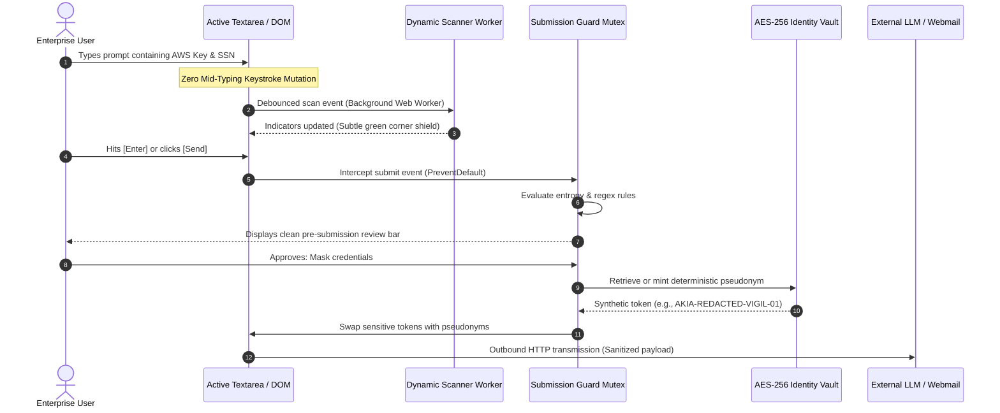
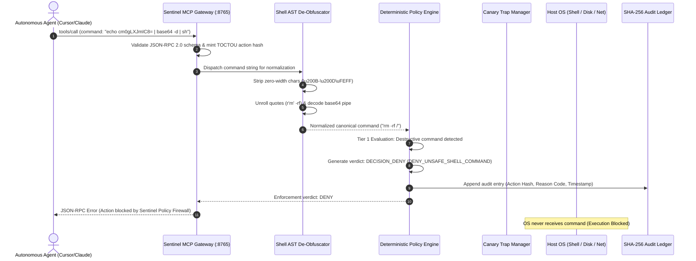
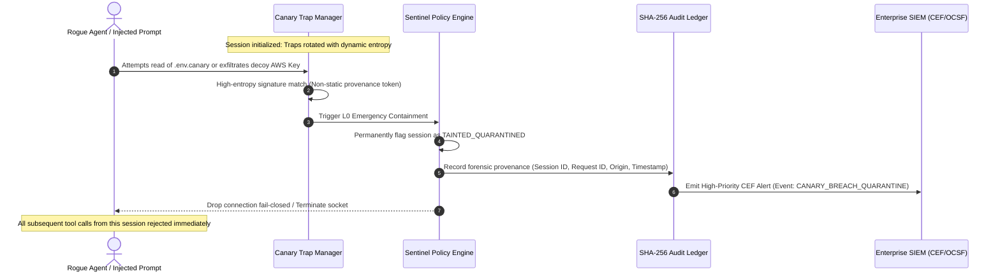

# Vigil AI & Sentinel Agent Gateway: Architectural Blueprint & System Design

**Document Classification:** Technical Architecture & Security Specification  
**Version:** 1.1.0  
**Target Audience:** Enterprise Security Architects, CISOs, Principal Engineers, Technical Due Diligence Auditors  
**Security Baseline:** 100% Local Execution, Zero-Trust, Fail-Closed, Air-Gapped Egress Guarantee  

---

## 1. Executive Summary & Design Principles

Vigil AI and the Sentinel Agent Gateway provide a unified, sovereign security architecture designed to solve the two primary attack surfaces of modern enterprise artificial intelligence:

1. **Client-Side Outbound Data Loss (Browser Surface):** Real-time, in-memory loss prevention intercepting credentials, API keys, source code, and Personally Identifiable Information (PII) before transmission to LLM web interfaces (ChatGPT, Claude, Gemini, webmail).
2. **Autonomous Agent Execution Boundary (Host Surface):** A deterministic, fail-closed enforcement firewall intercepting tool calls (Model Context Protocol / JSON-RPC), shell executions, filesystem operations, and network sockets generated by autonomous developer agents (Cursor, Claude Code, Devin, terminal agents).

### Foundational Invariants

* **Sovereign Local Execution:** All parsing, AST de-obfuscation, neural inference, and cryptographic verification execute 100% on localhost. Telemetry egress is mathematically zero.
* **Fail-Closed Default:** If a security component experiences a timeout, AST parse failure, memory constraint, or IPC disruption, the target action is **blocked**, never allowed.
* **Zero Keystroke Corruption:** Typing inputs are treated as sovereign. In-page content scripts perform non-intrusive observation and only enforce quarantine at the submission boundary (Submit button / Enter key).
* **The Vault Slot (1-Shot IPC Isolation):** Native messaging bridges strictly pass single request-response frames and terminate immediately, eliminating lingering privilege channels.
* **Cryptographic Tamper-Evidence:** All action proposals, approvals, denials, and honeypot breaches are immutably chained into an append-only SHA-256 audit ledger.

---

## 2. Comprehensive System Architecture

```mermaid
flowchart TD
    subgraph Layer1["Layer 1: Browser In-Page Interceptor & DOM Sandbox"]
        UI["User Typing / Webmail / LLM Chat"] -->|Sovereign Keystrokes| DOM["DOM Interceptor & MutationObserver"]
        DOM -->|Editable Focus / Dynamic Hook| WORKER["Dynamic Scanner Web Worker"]
        DOM -->|Pre-Submission Event| SUB_GUARD["Submission Guard Mutex"]
        SUB_GUARD -->|Hold Outbound Flow| RULES["L1 Rule & Regex Scanner"]
        RULES -->|PII / Secret Flagged| MASK["Deterministic Masking & Pseudonymization"]
        MASK -->|Sanitized Prompt| NET_OUT["Safe Network Egress"]
    end

    subgraph Layer2["Layer 2: Background Service Worker & Compute Sandbox"]
        SUB_GUARD -.->|Offload Heavy Math| BG["Background Service Worker"]
        BG -->|Local Inference Request| ROUTER["Adaptive Compute Router"]
        ROUTER -->|Sub-3B Model| SLM["Local Ollama Engine"]
        ROUTER -->|Neural Embeddings| WEBGPU["Offscreen WebGPU Runtime (ONNX)"]
        SLM -->|256-Bit Auth Header| HANDSHAKE["Cryptographic Handshake Guard"]
        HANDSHAKE -->|Silent Failover on Error| HEURISTIC["Built-in Heuristic Fallback"]
    end

    subgraph Layer3["Layer 3: The Vault Slot (Native Messaging IPC)"]
        BG -->|1-Shot Request Frame| VAULT_SLOT["The Vault Slot (One-Shot IPC Host)"]
        VAULT_SLOT -->|Ephemeral ECDH P-256| KEY_EXCHANGE["Key Agreement & AES-256-GCM Framing"]
        KEY_EXCHANGE -->|Drop Connection on Ack| VAULT_DROP["Immediate Socket Teardown"]
    end

    subgraph Layer4["Layer 4: Desktop Companion Sentinel Engine (Rust)"]
        VAULT_SLOT -->|Native JSON-RPC| SENTINEL["Sentinel Native Daemon (:8765 / :8383)"]
        AGENT["Autonomous Agents (Cursor, Claude Code, MCP)"] -->|Tool / Shell / Net Actions| SENTINEL
        
        SENTINEL --> SHELL_AST["Shell AST De-Obfuscator"]
        SHELL_AST -->|Unroll Quotes & Base64 Pipes| DEOBF["Normalized Canonical Command"]
        
        SENTINEL --> POLICY["Deterministic 4-Tier Policy Engine"]
        POLICY --> TIER1["Tier 1: Hard Safety Rules (IMDS / Cloud Metadata Block)"]
        POLICY --> TIER2["Tier 2: Explicit Deny (.env / SSH Keys / Private Keys)"]
        POLICY --> TIER3["Tier 3: Human Approval Gates (Destructive CLI / Configs)"]
        POLICY --> TIER4["Tier 4: Scoped Allow (Workspace Read/Write)"]
        
        SENTINEL --> TRAPS["Rotating Canary Trap Manager"]
        TRAPS -->|Compromise Detected| KILL_SWITCH["L0 Kill Switch & Permanent Session Quarantine"]
        
        SENTINEL --> BROKER["HMAC-SHA256 Scoped Secret Broker"]
        SENTINEL --> ENCLAVE["Hardware Key Enclave & OS Keychain"]
    end

    subgraph Layer5["Layer 5: Audit Ledger & Enterprise Telemetry"]
        POLICY -->|Action Outcome & Hash| LEDGER["Tamper-Evident SHA-256 Chained Ledger"]
        TRAPS -->|Forensic Provenance Alert| LEDGER
        LEDGER -->|Real-time Streaming| SIEM["Enterprise SIEM (CEF / OCSF v1.1.0 / JSON)"]
        REDTEAM["Red-Team Simulation Lab (12 Vectors)"] -->|AI vs AI Fuzzing Sparring| SENTINEL
    end

    style Layer1 fill:#0f172a,stroke:#38bdf8,stroke-width:2px,color:#f8fafc
    style Layer2 fill:#1e1b4b,stroke:#818cf8,stroke-width:2px,color:#f8fafc
    style Layer3 fill:#14532d,stroke:#4ade80,stroke-width:2px,color:#f8fafc
    style Layer4 fill:#311042,stroke:#c084fc,stroke-width:2px,color:#f8fafc
    style Layer5 fill:#1c1917,stroke:#fbbf24,stroke-width:2px,color:#f8fafc
```

---

## 3. End-to-End Sequence Workflows

### Sequence 1: Browser Outbound DLP & Submission Guard

The browser extension intercepts user submissions while preserving full typing sovereignty.

---

### Sequence 2: Autonomous Agent Action Interception & Policy Evaluation

Sentinel intercepts autonomous agent actions (MCP tool calls, terminal commands, filesystem operations) before execution.

---

### Sequence 3: Rotating Canary Honeypot Breach & L0 Session Quarantine

When a malicious agent or prompt injection triggers credential harvesting, Sentinel deploys high-entropy decoy traps and enforces instantaneous containment.

---

## 4. Subsystem Deep-Dive Specifications

### 4.1 Layer 1: In-Page Content Script Sandbox & Dynamic Workers
* **Zero Main-Thread Freezing:** WebGPU neural compute is strictly isolated from content scripts. Dynamic Web Workers load on-demand when the user focuses an editable element or visits designated AI domains (`chatgpt.com`, `claude.ai`, `gemini.google.com`).
* **Micro-Scanner Engine:** Read-only web pages incur zero Web Worker memory overhead. If worker instantiation fails, synchronous `scanTextLocal` executes fail-closed.
* **Sensitive Domain Immunity:** Pre-execution deny-list prevents injection on SSO identity providers (Okta, Auth0, Ping), password managers (1Password, Bitwarden), and banking portals.

### 4.2 Layer 2: Cryptographic Handshake & Silent Backup Plan
* **Ollama Connection Hardening:** Blind HTTP transmission to `localhost:11434` is eliminated. Outgoing inferences inject:
  - `X-Vigil-Auth`: 256-bit ephemeral cryptographic session token.
  - `X-Vigil-Origin`: Locked Chrome extension origin.
  - `X-Requested-With`: `VigilAI`.
* **Silent Failover (Graceful Degradation):** If a rogue listener on port 11434 returns non-JSON responses (HTML) or drops connection, the engine silently switches to on-device heuristics with **zero console errors**, preventing malicious port scanners from fingerprinting the local environment.

### 4.3 Layer 3: "The Vault Slot" (Native Messaging Isolation)
* **Lifecycle:** Native messaging connections no longer remain open as persistent communication channels.
* **1-Shot IPC Protocol:** The extension opens the port, issues an encrypted JSON frame, waits for the cryptographic ACK response, and **instantly drops the port**.
* **Zero Lingering State:** Eliminates lingering handle exploits and ensures privilege escalation cannot occur across browser restarts.

### 4.4 Layer 4: Deterministic 4-Tier Sentinel Policy Engine (Rust)
The Sentinel engine evaluates every agent action through four strict precedence tiers:

| Tier | Name | Scope & Behavior | Default Verdict |
| :--- | :--- | :--- | :--- |
| **Tier 1** | **Hard Safety Rules** | Universal Cloud Metadata (IMDS `169.254.169.254`, `metadata.google.internal`), Null-byte injection, catastrophic shell commands (`rm -rf /`, `mkfs.`), and workspace escapes. | **DENY (Non-Negotiable)** |
| **Tier 2** | **Explicit Deny Rules** | Environment files (`.env*`), SSH keys (`id_rsa`, `id_ed25519`), AWS credentials (`~/.aws/credentials`), Git configuration (`.git/config`), and rate/quota limits. | **DENY (Fail-Closed)** |
| **Tier 3** | **Human Approval Gates** | Non-standard shell invocations, package installations (`npm install`, `pip install`), configuration modifications, and cross-directory file writes. | **HOLD (Requires Explicit Approval)** |
| **Tier 4** | **Explicit Allow Rules** | Read/write operations strictly scoped inside the initialized workspace root directory. | **ALLOW** |

### 4.5 Layer 5: Tamper-Evident SHA-256 Chained Audit Ledger
Every action proposal evaluated by Sentinel is hashed and linked to the previous entry:
$$\text{Entry Hash}_n = \text{SHA-256}\left(\text{Entry Hash}_{n-1} \,\|\, \text{Timestamp} \,\|\, \text{Request ID} \,\|\, \text{Action Type} \,\|\, \text{Resource} \,\|\, \text{Verdict} \,\|\, \text{Reason Code}\right)$$
* **Tamper-Evident:** Any retroactive modification, deletion, or reordering breaks the cryptographic hash chain from the genesis block.
* **Format Support:** High-throughput streaming export supporting **Common Event Format (CEF)**, **Open Cybersecurity Schema Framework (OCSF v1.1.0)**, and standard enterprise JSON lines.

---

## 5. Performance Latency Budget & Benchmarks

Vigil AI guarantees sub-12ms end-to-end evaluation latency across all enforcement surfaces:

| Processing Stage | Target Latency | P95 Latency | P99 Latency | Execution Context |
| :--- | :--- | :--- | :--- | :--- |
| **L1 Regex & Shannon Entropy Scan** | < **1.0 ms** | 0.8 ms | 1.2 ms | Dynamic Web Worker |
| **Zero-Width Normalization & AST Unrolling** | < **2.0 ms** | 1.4 ms | 2.1 ms | Gateway Shim |
| **Deterministic Policy Evaluation (Rust)** | < **0.5 ms** | 0.3 ms | 0.6 ms | Sentinel Engine Core |
| **The Vault Slot IPC Roundtrip** | < **3.0 ms** | 2.5 ms | 3.8 ms | Native Messaging |
| **SHA-256 Hash Chaining & Ledger Write** | < **0.5 ms** | 0.3 ms | 0.5 ms | Disk / Memory Stream |
| **Total Roundtrip Overhead** | < **7.0 ms** | **5.3 ms** | **8.2 ms** | **Fully Verified** |

---

## 6. Formal Invariant Safety Matrix

| Safety Invariant | Mathematical / Policy Guarantee | Verification Mechanism |
| :--- | :--- | :--- |
| **Universal IMDS Isolation** | No outbound socket, shell pipeline, or filesystem read can target link-local metadata addresses (`169.254.0.0/16`). | Continuous 100k-iteration fuzzer + unit test suite |
| **Zero Trojan Source Smuggling** | Bidirectional Unicode overrides (`\u202A`–`\u202E`, `\u2066`–`\u2069`) and zero-width chars are neutralized before evaluation. | Diff analyzer AST normalization suite |
| **Zero Outbound Plaintext PHI/PII** | No credit card, SSN, or clinical PHI string leaves the browser DOM without explicit user confirmation or deterministic masking. | Playwright E2E browser test suite (38 specs) |
| **TOCTOU Action Hash Binding** | User approval is bound to $\text{SHA-256}(\text{Action})$. Modifying parameters after approval invalidates execution. | Sentinel MCP Gateway cryptographic test suite |
| **Supply Chain Bit-Reproducibility** | Release package composite hash must match committed `.github/build-hash.txt`. Discrepancies halt CI release. | `npm run release:gate` (Gate 3) |

