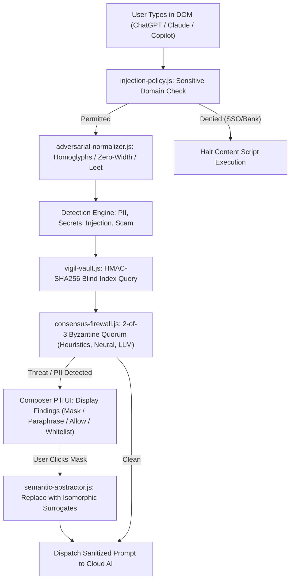
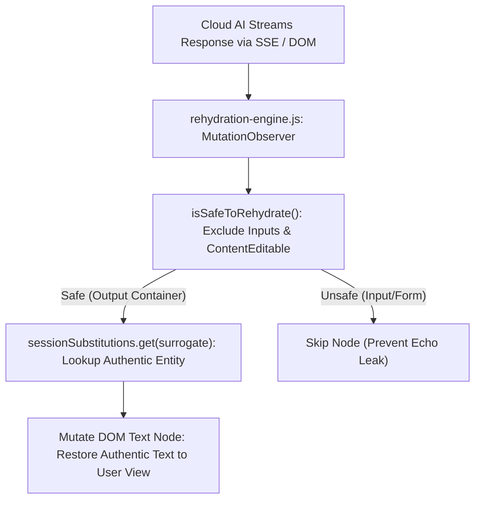
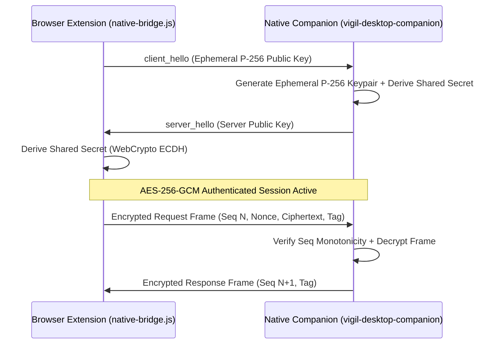

# VIGIL AI — Phase Zero Discovery: Baseline Security & Repository Audit

> **Generated:** Phase Zero Discovery Execution  
> **Repository:** [starboy-hub/vigil.ai](https://github.com/starboy-hub/vigil.ai.git)  
> **Specification Reference:** [Roadmap.md](file:///home/STARBOY/gemini/antigravity/scratch/vigil.ai/Roadmap.md) — Section 2 (Phase Zero)

---

## 1. Git & Environment Baseline

| Parameter | Current Baseline |
|---|---|
| **Current Branch** | `main` |
| **Commit SHA** | `fb0baf7bf588544952c3cecd74c9238eddd9c56a` |
| **Working Tree Status** | Clean (`nothing to commit, working tree clean`) |
| **Remote Origin** | `https://github.com/starboy-hub/vigil.ai.git` (synchronized with `origin/main`) |
| **Host Environment** | Linux (Fedora 40 x86_64, Kernel 6.11+), KDE Plasma 6 Wayland |
| **Node.js / npm** | Node.js v22 LTS, npm 10.x |
| **Rust Toolchain** | rustc 1.85.0 / cargo 1.85.0 (x86_64-unknown-linux-gnu) |
| **Browser Runtimes** | Chromium (MV3), Mozilla Firefox (MV3) |

---

## 2. Comprehensive Component Inventory

### A. Browser Extension Frontend & Injection

| Component | Primary Files | Responsibilities | Trust Boundary | Dependencies | Existing Tests | Status |
|---|---|---|---|---|---|---|
| **Manifests** | `src/manifest.json`, `dist/manifest.json`, `dist-firefox/manifest.json` | Extension permissions, CSP, content scripts, background worker declarations | Browser sandbox | MV3 specification | `release-gate.js` (Gates 1, 2, 5) | ✅ Implemented & Verified |
| **Sensitive Injection Policy** | `src/content/modules/injection-policy.js` | Pre-execution gatekeeper: blocks content scripts on SSO, banking, password managers | Content Script vs Untrusted DOM | None (pure JS) | `tests/injection-policy.test.js` | ✅ Implemented & Verified |
| **Main Content Script** | `src/content/content.js` | DOM input monitoring, Composer Pill overlay, DOM mutation observers | Untrusted Webpage DOM | Content modules | `tests/dom-injection.test.js`, `tests/granular-ignore-and-spa.test.js` | ✅ Implemented & Verified |
| **Adversarial Normalizer** | `src/content/modules/adversarial-normalizer.js` | Normalizes zero-width smuggling, homoglyphs, leet-speak, fullwidth Unicode | Content script pre-processor | None (pure JS) | `tests/adversarial-normalizer.test.js`, `tests/fuzz-normalizer.test.js` | ✅ Implemented & Verified |
| **Detection Engine** | `src/content/modules/detection-engine.js` | Regex + heuristic scanning for PII (CC, SSN, emails, bank accounts, phones) | In-memory scanner | `vigil-shared.js` | `tests/detection.test.js`, `tests/detection-engine.test.js` | ✅ Implemented & Verified |
| **Secret & Key Engine** | `src/content/modules/secret-engine.js` | Shannon entropy + pattern matching for AWS, GitHub PATs, Stripe keys | In-memory scanner | None (pure JS) | `tests/detection.test.js` | ✅ Implemented & Verified |
| **Injection Engine** | `src/content/modules/injection-engine.js` | Detects prompt injection, jailbreak delimiters, system overrides | In-memory scanner | None (pure JS) | `tests/injection.test.js` | ✅ Implemented & Verified |
| **Sentinel (Phishing/Scam)** | `src/content/modules/sentinel-engine.js` | Scam heuristics, urgency pressure, typosquatting, wallet scams | In-memory scanner | None (pure JS) | `tests/sentinel.test.js` | ✅ Implemented & Verified |
| **Webmail Profile** | `src/content/modules/webmail-profile.js` | Email headers, sender mismatch, hidden link destination analysis | Webmail DOM (Gmail, Outlook) | `sentinel-engine.js` | `tests/webmail.test.js` | ✅ Implemented & Verified |
| **Honeytoken Canary Generator** | `src/content/modules/honeytoken-canary-generator.js` | Generates invisible DOM decoy credentials; alerts on exfiltration echo | Untrusted DOM tripwire | WebCrypto | `tests/honeytoken-canary.test.js` | ✅ Implemented & Verified |
| **Semantic Abstractor** | `src/content/modules/semantic-abstractor.js` | Isomorphic surrogate mapping for clinical, financial, legal entities | Client-side transformer | `vigil-vault.js` | `tests/semantic-abstractor.test.js` | ✅ Implemented & Verified |
| **Rehydration Engine** | `src/content/modules/rehydration-engine.js` | Restores original entities into streaming AI responses in DOM | DOM Mutation Observer | `isSafeToRehydrate` validator | `tests/rehydration-engine.test.js` | ✅ Implemented & Verified |
| **K-Anonymity Auditor** | `src/content/modules/k-anonymity-auditor.js` | Sweeney & Rocher quasi-identifier demographic entropy calculation | In-memory auditor | None (pure JS) | `tests/k-anonymity.test.js` | ✅ Implemented & Verified |
| **Vision Canary & Firewall** | `src/content/modules/vision-canary.js`, `src/content/modules/vision-firewall.js` | Canvas steganography, Laplacian frequency filtering, pHash | Image / Canvas decoding | `wasm-simd-fft.js`, `phash.js` | `tests/vision-canary.test.js` | ✅ Implemented & Verified |
| **WASM SIMD FFT** | `src/content/modules/wasm-simd-fft.js` | Accelerated 2D Fourier transforms for spatial frequency analysis | WASM runtime | WebAssembly | `tests/wasm-simd-fft.test.js` | ✅ Implemented & Verified |

---

### B. Background Service Worker & AI Defense Brain

| Component | Primary Files | Responsibilities | Trust Boundary | Dependencies | Existing Tests | Status |
|---|---|---|---|---|---|---|
| **Background Orchestrator** | `src/background/background.js` | Message bus, alarms, context menus, state coordination | Chrome Extension Core | All background modules | Integrated via end-to-end tests | ✅ Implemented & Verified |
| **Identity Vault** | `src/background/vigil-vault.js` | AES-256-GCM encrypted PII vault with HMAC blind indexing & burner mode | WebCrypto / `chrome.storage.local` | Non-extractable CryptoKey | `tests/vault.test.js`, `tests/burner-identity.test.js` | ✅ Implemented & Verified |
| **Byzantine Consensus Firewall** | `src/background/consensus-firewall.js` | 2-of-3 Byzantine quorum voting across heuristics, neural head, and LLM | Multi-model arbiter | Engine runners | `tests/consensus-firewall.test.js` | ✅ Implemented & Verified |
| **Adaptive Inference Router** | `src/background/adaptive-router.js` | Dynamic routing between fast System 1 SLMs and System 2 reasoning models | Local Ollama IPC | `http://127.0.0.1:11434` | `tests/adaptive-router.test.js` | ✅ Implemented & Verified |
| **On-Device LoRA & DPO** | `src/background/local-lora.js` | Rank-4 LoRA adapter SGD training, ring buffer, differential privacy | Local in-memory adapter | Matrix Math (JS) | `tests/local-lora.test.js` | ✅ Implemented & Verified |
| **Adversarial Red-Team Agent** | `src/background/redteam-agent.js` | Generates 6 mutation types during system idle to stress-test defenses | Autonomous self-play | `local-lora.js` | `tests/redteam-agent.test.js` | ✅ Implemented & Verified |
| **Semantic Drift Sentinel** | `src/background/semantic-drift.js` | 128-d vector trajectory tracking to detect multi-turn grooming | Multi-turn memory | Embeddings engine | `tests/semantic-drift.test.js` | ✅ Implemented & Verified |
| **Forensics Replay Engine** | `src/background/forensics-replay.js` | High-precision latency profiling and sub-rule decision replay | Debugging / Audit | Defense modules | `tests/forensics-replay.test.js` | ✅ Implemented & Verified |
| **Prompt Git Engine** | `src/background/prompt-git.js` | Local branching, commits, and diffs for conversation histories | User storage | WebCrypto SHA-256 | `tests/prompt-git.test.js` | ✅ Implemented & Verified |
| **Jailbreak Shopping Detector**| `src/background/shopping-detector.js` | Detects cross-provider jailbreak testing within short time windows | Cross-tab session store | In-memory ring buffer | `tests/shopping-detector.test.js` | ✅ Implemented & Verified |
| **File Integrity Monitor** | `src/background/file-integrity.js` | Cryptographic SHA-256 hash manifest verification of extension files | Extension filesystem | WebCrypto | `tests/file-integrity.test.js` | ✅ Implemented & Verified |
| **WebGPU Neural Engine** | `src/background/webgpu-engine.js`, `src/background/offscreen.js` | MobileBERT / ONNX runtime in offscreen document | Offscreen Document | ONNX Runtime Web / Transformers.js | `tests/compute-boundary.test.js` | ⚠️ Verified with Fallback (ONNX binary omitted from repo) |
| **Swarm Threat Exchange** | `src/background/swarm-mesh.js`, `src/background/threat-store.js` | Hashed threat signature exchange over self-hosted relay | Network relay boundary | Local storage | `tests/relay.test.js` | ✅ Implemented & Verified |

---

### C. Native Desktop Companion (Rust) & Local Daemons

| Component | Primary Files | Responsibilities | Trust Boundary | Dependencies | Existing Tests | Status |
|---|---|---|---|---|---|---|
| **Native Host Daemon** | `desktop/src/main.rs` | Stdio native messaging bridge, ephemeral P-256 ECDH, AES-256-GCM channel | Browser-to-OS IPC | `p256`, `aes-gcm`, `keyring` | 19 tests in `desktop/Cargo.toml` | ✅ Implemented & Verified |
| **IDE Forward Proxy** | `desktop/src/ide_proxy.rs` | Port 8383 HTTP proxy; strips credentials from Cursor/Copilot/Ollama | OS loopback `127.0.0.1:8383` | `ureq`, `regex` | `tests::test_inspect_prompt_redacts_*` | ✅ Implemented & Verified |
| **Hardware Enclave Root** | `desktop/src/hardware_enclave.rs`| TPM/Secure Enclave hardware-backed key sealing with fail-closed checks | OS security enclave | `rand`, `aes-gcm` | `hardware_enclave::tests::*` | ✅ Implemented & Verified |
| **Audio Spectral Canary** | `desktop/src/audio_canary.rs`, `companion/voice-spectral-canary.js` | Detects ultrasonic / covert acoustic exfiltration | OS audio subsystem | `rustfft` | Integrated in companion tests | ✅ Implemented & Verified |
| **Agent Firewall Daemon** | `companion/vigil-agent-firewall.js` | Port 8765 proxy for autonomous agents; live SSE stream token rewriting | OS loopback `127.0.0.1:8765` | Node.js `http`, `net` | `tests/companion.test.js` | ✅ Implemented & Verified |
| **Desktop Launchers** | `companion/vigil-desktop-launcher.sh`, `playground/playground-launcher.sh` | Detached daemon management and direct browser launch | User desktop environment | Bash, Firefox/Chrome | Verified on Linux/KDE | ✅ Implemented & Verified |
| **Cyber Range Playground**| `playground/server.js`, `playground/index.html` | 6 interactive simulation stations for manual and automated validation | Local loopback `127.0.0.1:4006` | Node.js `http` | `tests/range/online-runner.spec.js` | ✅ Implemented & Verified |

---

## 3. Real Runtime Data Flows

### A. Outbound Prompt Transmission Flow

### B. Inbound Cloud Response Rehydration Flow

### C. Native Companion Cryptographic Handshake

---

## 4. Bypass, Override, and Fail-Open Analysis

| Surface | Mechanism | Implemented Behavior | Risk / Finding Reference |
|---|---|---|---|
| **Domain Gatekeeper** | `shouldInjectContentScript()` | Halts content script immediately on SSO / Banking / Password Managers | **F-01**: Intentional by design to prevent credential interference, but leaves those tabs uninspected. |
| **Whitelisted Domains** | `settings.trustedSites` | Bypasses all content script scanning on user-whitelisted domains | Working by design; bypass is explicit user decision. |
| **User Composer Pill** | "Allow" & "15m" snooze | User clicks "Allow" (passes this input) or "15m" (pauses 15m) | Explicit user override; recorded as DPO preference. |
| **Consensus Firewall Quorum** | `consensus-firewall.js` | `no BLOCK (any ABSTAINs) → allowed` | **F-04**: If no classifier blocks, prompt passes open. |
| **Consensus Timeout** | `content.js` (`CONSENSUS_TIMEOUT_MS`) | 4,000ms timeout defaults to `{ verdict: 'allowed' }` | **F-04**: Fails open on timeout to prevent blocking user typing indefinitely. |
| **Agent Firewall Endpoints**| `companion/vigil-agent-firewall.js` | `/vigil-mode` changes mode without `Origin` check | **F-02**: Localhost loopback lacks CSRF/Origin validation. |
| **CI Dependency Audits** | `.github/workflows/ci.yml` | `cargo audit` skips if binary missing; SBOM has `|| true` | **F-05**: CI security gate can silently pass without enforcement. |

---

## 5. Current Test & Quality Verification

| Test Suite | Commands Run | Results | Verification Date |
|---|---|---|---|
| **Jest Unit Test Suite** | `npm test` | **55 passed / 55 total** (709 tests passed, 0 failed) | 2026-10-11 |
| **Rust Native Tests** | `cargo test --manifest-path desktop/Cargo.toml` | **19 passed / 19 total** (0 failed) | 2026-10-11 |
| **Linter** | `npm run lint` | **0 errors / 0 warnings** | 2026-10-11 |
| **Adversarial Benchmark** | `node scripts/adversarial-benchmark.js` | **160/160 caught (100%), 0/20 benign FP (0%)** | 2026-10-11 |
| **Release Pipeline Gate** | `npm run release:gate` | **All 7 Security Release Gates Passed** | 2026-10-11 |

